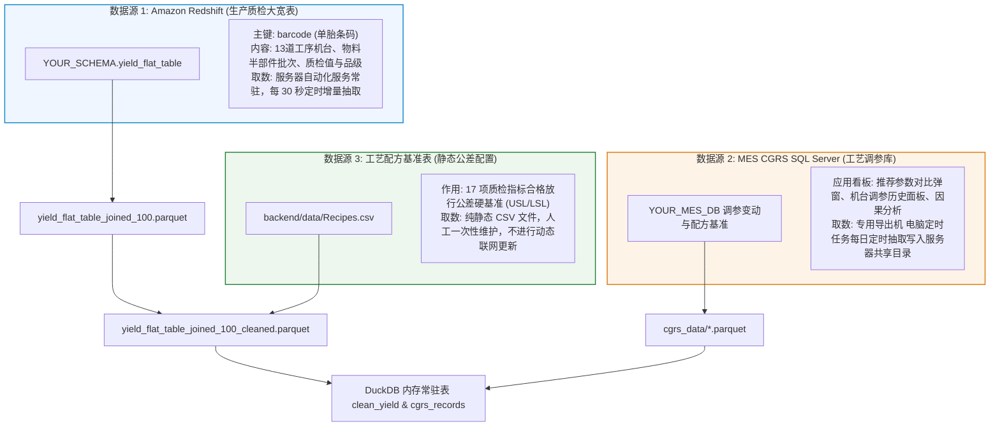
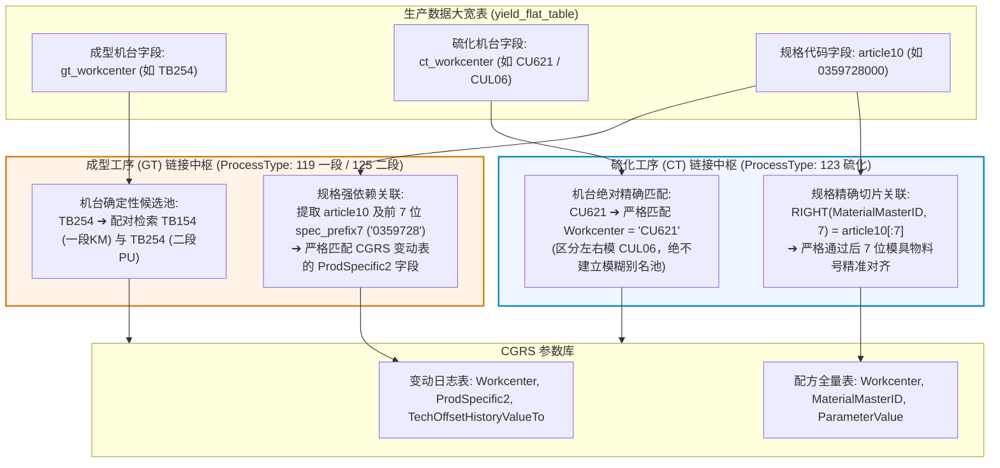

# 02. 数据源与实体关系 (Data Sources & ER Flow)

---

## 1. 三大物理数据源与抽取边界

系统的分析中枢由三大物理数据源共同供数，各数据源职能、业务定位与技术参数如下：



### 1.1 数据源 1：Amazon Redshift 轮胎生产与质检大宽表 ［[👉 具体抽取逻辑指引 (03章)](03_etl_pipeline_and_engine.md)］
* **业务含义与数据内容**：
  * 该表为工厂轮胎制造的**全生命周期事实大宽表**，以**单胎条码 (`barcode`)** 为全局唯一主键；
  * 完整记录单条轮胎从半部件组装、成型、硫化到终检流转的**机台设备信息**（如 `gt_workcenter`, `ct_workcenter`, `tu_first_workcenter`）、**原材料半部件批次**（胎面 Tread Lot、胎圈 Bead Lot、内衬 InnerLiner Lot、带束层 Breaker Lot 等）、工序出产时间戳，以及 TU/TG/TB 17 项最终质检实测值与合格品级 Grade。
* **连接配置**：
  * 主机与凭据：配置于 `backend/config/db_config.json`（经 XOR 对称加密保护）；
  * 端口：`5439`，数据库：`YOUR-DATAWAREHOUSE`，模式与表：`YOUR_SCHEMA.yield_flat_table`。
* **取数方式与定时策略**：
  * **高频增量同步**：由部署在生产服务器上的常驻后台 ETL 守护进程运行，**设定每 30 秒执行一次的增量抽取定时任务**；
  * **安全水位线**：依据本地 Parquet 已有数据的最大终检时间戳安全回退 1 天 (`safe_watermark`)，兼顾实时性与网络颠簸断流后的自动数据对齐；
  * **冷启动时间窗**：首次初始化默认全量回溯过去 31 天数据。

### 1.2 数据源 2：MES CGRS 机器工艺调参数据库
* **业务含义与看板应用**：
  * 记录工厂成型机与硫化机关键工艺参数的标准基准值（`ParameterValue`）与历史工艺调参变动轨迹（`TechOffsetHistoryValueTo` 生效偏置）；
  * **支撑的前端核心看板**：
    1. **【核心规格行动表 - 查看推荐参数弹窗】**：为工艺员呈现机台当前参数、配方基准与优化推荐值；
    2. **【单机台点击下钻调参轨迹面板】**：展示特定机台近期的调参事件点及调参前后 CPK 波动；
    3. **【CGRS 调参因果回溯分析引擎】**：评估工艺干预究竟是让质量变好还是变差。
* **连接配置**：
  * 服务器：`YOUR-MES-HOST\YOUR-MES-INSTANCE`；
  * 数据库：`YOUR_MES_DB`（基于 Windows 局域网集成认证 / ODBC 驱动）。
* **取数方式与定时策略**：
  * **离线定时抽取**：由 **专用导出机上的定时任务**每日定时执行抽取脚本；
  * **文件落地归档**：将全厂调参日志抽取为每日增量文件 `recipe_offset_changes_YYYYMMDD.parquet` 及配方参数全量基准 `recipe_full_params_YYYYMMDD.parquet`，并自动推送同步至生产服务器共享目录 `\\YOUR-SERVER-IP\tu ai\TireWeight_Uniformity_Analysis\cgrs_data`。

### 1.3 数据源 3：配方标准上限与公差基准表 (`Recipes.csv`)
* **文件存储位置**：`backend/data/Recipes.csv`；
* **取数方式说明**：
  * **纯静态离线配置文件**：该表为工厂质检工艺标准的一次性手工维护表，**系统不会对其进行任何动态联网轮询与自动更新**；
  * **关联键**：`LPAD(TRIM(CAST(ART10 AS VARCHAR)), 10, '0')`（10 位左补零规格码）；
* **业务含义**：提供轮胎行业最权威的质检放行标准上限（USL）与公差下限（LSL），包含 `standard_rfpp`、`standard_rfh1`、`conny_usl/lsl`、`tbul_usl` 等，是全厂 CPK 计算唯一遵循的“法定公差标尺”。

---

## 2. 13 道工序流转与单胎生命周期

在 `backend/services/process_flow_service.py` 中，定义了全厂 13 道核心物理工段拓扑字典：

```python
# 代码位置：backend/services/process_flow_service.py:L21-35
WORKCENTER_STAGES = [
    {"key": "tread",       "col": "tread_workcenter",           "name": "胎面"},
    {"key": "bead",        "col": "bead_workcenter",            "name": "胎圈"},
    {"key": "inner_liner", "col": "inner_liner_workcenter",     "name": "内衬"},
    {"key": "sidewall",    "col": "sidewall_workcenter",        "name": "胎侧"},
    {"key": "breaker1",    "col": "first_breaker_workcenter",   "name": "带束层1"},
    {"key": "breaker2",    "col": "second_breaker_workcenter",  "name": "带束层2"},
    {"key": "ply1",        "col": "first_ply_workcenter",       "name": "帘布层1"},
    {"key": "cap1",        "col": "wound_cap_ply1_workcenter",  "name": "冠带层1"},
    {"key": "cap2",        "col": "wound_cap_ply2_workcenter",  "name": "冠带层2"},
    {"key": "gt",          "col": "gt_workcenter",              "name": "成型"},
    {"key": "ct",          "col": "ct_workcenter",              "name": "硫化"},
    {"key": "tu",          "col": "tu_first_workcenter",        "name": "终检"},
    {"key": "tb",          "col": "tb_first_workcenter",        "name": "动平衡"},
]
```

### 关键控制工步三元组 (GT ➔ CT ➔ TU)
在质量分析中，重点收敛于**“成型 (GT) ➔ 硫化 (CT) ➔ 终检 (TU)”**这三道物理变异影响最大的决定性工序：
* **成型 (GT, 如 TB254, GT02)**：帘布组装、胎圈贴合与生胎成型；
* **硫化 (CT, 如 CU621, CU704)**：高温高压胶囊硫化，机械应力定型；
* **终检 (TU, 如 TU05, TU19)**：均匀性试验机对轮胎径向力、侧向力与锥度进行高精度负荷传感器采样。

---

## 3. 生产数据表与 CGRS 参数库跨表连接规则详解

在智能看板将“生产质量变异”与“机台工艺调参”建立因果关联时，**生产数据大宽表 (`yield_flat_table`)** 与 **CGRS 调参变动日志表 (`recipe_offset_changes_*.parquet`)**、**CGRS 配方参数全量表 (`recipe_full_params_*.parquet`)** 必须通过精密的跨系统字段映射规则完成连接。

由于现场**成型 (GT)** 与**硫化 (CT)** 设备的工艺控制逻辑存在本质差异，系统制定了截然不同且高度细致的字段连接规范：



### 3.1 三张核心数据表的实体关系字段映射字典

| 对比维度 | 生产数据大宽表 (`yield_flat_table`) | CGRS 调参变动日志修改表 (`recipe_offset_changes_*.parquet`) | CGRS 配方参数基准全量表 (`recipe_full_params_*.parquet`) |
| :--- | :--- | :--- | :--- |
| **单胎唯一标识** | **`barcode`**（全厂主键） | *无（CGRS 记录机台工艺配置，不存单胎条码）* | *无（CGRS 记录机台配方标准，不存单胎条码）* |
| **机台编码字段** | `gt_workcenter` (成型) / `ct_workcenter` (硫化) | **`Workcenter`** | **`Workcenter`** |
| **工序分类代码** | 13 道物理工段分类字符串 | **`ProcessTypeID`**<br/>(119=成型一段KM, 125=成型二段PU, 123=硫化) | **`ProcessTypeID`**<br/>(119=成型一段KM, 125=成型二段PU, 123=硫化) |
| **规格标识字段** | **`article10`** (10 位完整生产代号) | **`ProdSpecific2`** (辅以 `ProdSpecific1`) | **`MaterialMasterID`** (辅以 `RecipeDescription`) |
| **参数状态值** | 17 项质检最终测量值 | `TechOffsetHistoryValueTo` (修改后偏置)<br/>`TechOffsetHistoryLocalDate` (修改日期) | **`ParameterValue`** (配方基准值) |

---

### 3.2 成型工序 (GT: KM一段 & PU二段) 详细连接规则

成型工序涵盖“一段生胎成型 (KM, ProcessType 119)”与“二段胎胚贴合 (PU, ProcessType 125)”，其跨表连接**同时强依赖“机台配对映射”与“规格代码双向过滤”**：

#### 规则 1：机台候选池的拆分映射 (`Workcenter`)
* **痛点**：生产大宽表记录的成型机编码通常为二段机台格式（如 `TB254` 或 `GT02`），但一段成型（如内衬层贴合摩擦力、胎圈反包位置）在 CGRS 中是挂载在一段设备（如 `TB154`）下的；
* **算法实现**（`get_machine_candidates`）：
  - 传入 `TB2xx` ➔ 自动派生候选池 `['TB2xx', 'TB1xx', 'TBxx']`；
  - 传入 `TB1xx` ➔ 自动派生候选池 `['TB1xx', 'TB2xx', 'TBxx']`；
  - 传入 `Fxx` ➔ 自动派生 `['TB1xx', 'TB2xx']`。
* **业务效果**：确保在查询一台成型机时，能无缝同时拉出该设备**一段 KM (26项)** 与**二段 PU (30项)** 的全部调参记录。

#### 规则 2：规格字段的强依赖匹配 (`article10` ➔ `ProdSpecific2`)
* **匹配字段**：在 CGRS 变动日志表中，规格并非存放在 `article10`，而是严格存储在 **`ProdSpecific2`**（部分老数据在 `ProdSpecific1`）；
* **链接逻辑**：
  1. 系统提取生产大宽表的 `article10`（如 `0359728000`）及**前 7 位核心前缀 `spec_prefix7`**（`0359728`）；
  2. SQL 强链接条件：
     ```sql
     AND (
         ProdSpecific2 = '0359728000' 
         OR ProdSpecific2 LIKE '0359728%' 
         OR ProdSpecific2 LIKE '%359728%'
         OR ProdSpecific1 = '0359728000'
         OR ProdSpecific1 LIKE '0359728%'
     )
     ```
  3. **优先级保证**：优先获取同机台加工该专属规格（`ProdSpecific2`）时的最新生效偏置；若该机台此前从未针对该规格修改过该参数，则前端明确标示为未修改（`-`），绝不虚构默认值。
* **全量基准表的规格特征回退**：
  - 在全量底表中，若机台录入了专属规格或配方描述（`RecipeDescription` 包含 `245/50R18` 等尺寸特征），优先提取专属基准值；若未针对特定规格设置专属基准，则安全回退至该机台的工程通用基准。

---

### 3.3 硫化工序 (CU: ProcessType 123) 详细连接规则

硫化工序与成型工序完全不同，其模具与机台属于绝对物理刚性绑定，连接规则遵循**“机台零模糊、规格后7位严格对齐”**：

#### 规则 1：机台严格精确匹配 (`Workcenter`)
* **红线准则**：硫化机台**绝不生成任何候选别名池**。
* **物理意义**：生产表若是 `CU621`，CGRS 中就只精确查询 `Workcenter = 'CU621'`；左模（如 `CUL06`）与右模（如 `CUG06`）的温控与保压参数彼此独立，系统**严禁将左模与右模互相借用或模糊匹配**。

#### 规则 2：规格精确切片匹配 (`MaterialMasterID`)
* **匹配字段**：硫化工艺全量表直接采用 **`MaterialMasterID`** 字段关联；
* **链接逻辑**：
  - 硫化模具代码在 CGRS 中记录为 10 位物料主数据号；
  - 连接条件严格执行**后 7 位对齐**：
    ```sql
    WHERE Workcenter = '{ct_workcenter}'
      AND TRY_CAST(ProcessTypeID AS VARCHAR) = '123'
      AND (
          RIGHT(CAST(MaterialMasterID AS VARCHAR), 7) = '{article10[:7]}'
          OR CAST(MaterialMasterID AS VARCHAR) LIKE '%{article10[:7]}%'
      )
    ```
  - **业务效果**：确保提取的模温、充气内压等基准参数 100% 对应同模具型腔，防止不同规格模具参数发生串位。

---

## 4. 核心数据表字段字典与外键映射

### 4.1 宽表核心字段清单 (`clean_yield`)
| 字段名 | 业务含义 | 数据类型 | 典型示例 | 关联/处理说明 |
| :--- | :--- | :--- | :--- | :--- |
| `barcode` | 单胎条码 | VARCHAR (主键) | `035972800012345` | 全流程唯一标识 |
| `article10` | 10位规格代号 | VARCHAR | `0359728000` | 关联配方表与指标上限 |
| `tu_first_loc_timestamp` | 终检出产时间戳 | TIMESTAMP | `2026-09-15 14:20:00` | 核心时间轴 |
| `tu_first_shift_date` | 生产排产班次日 | VARCHAR | `2026-09-15` | `timestamp - 8小时` 派生 |
| `gt_workcenter` | 成型机台编码 | VARCHAR | `TB254`, `GT02` | 对应三期/四期成型设备 |
| `ct_workcenter` | 硫化机台编码 | VARCHAR | `CU621`, `CUL02` | 对应三期/四期硫化机 |
| `tu_first_workcenter` | 终检机台编码 | VARCHAR | `TU05`, `TU19` | 对应均匀性检测机 |
| `ct_shop` | 厂区车间期别 | VARCHAR | `P3`, `P4` | 判定三期/四期归属 |
| `rfppwc_first` | 径向力峰峰值原始测量值 | DOUBLE | `102.5` | 计算时需 $\times 10$ 换算为牛 (N) |
| `cony_first` | 锥度效应力原始测量值 | DOUBLE | `45.2` | 单位为牛 (N)，双侧公差 |
| `tbul_first` | 上胎侧凸起测量值 | DOUBLE | `0.45` | ETL 清洗后已转为毫米 (mm) |
| `standard_rfpp` | RFPP 配方标准上限 | DOUBLE | `105.0` | 来自 `Recipes.csv` |
| `conny_usl / lsl` | CONY 配方上下限 | DOUBLE | `80.0 / -80.0` | 来自 `Recipes.csv` |

---

> [!TIP]
> **下一章导航**：
> 掌握了数据源与跨表字段连接规则后，请阅读 [03. ETL 流式清洗管线与 DuckDB 内存引擎](03_etl_pipeline_and_engine.md)，了解如何将原始数据高效流式清洗至内存引擎中。
