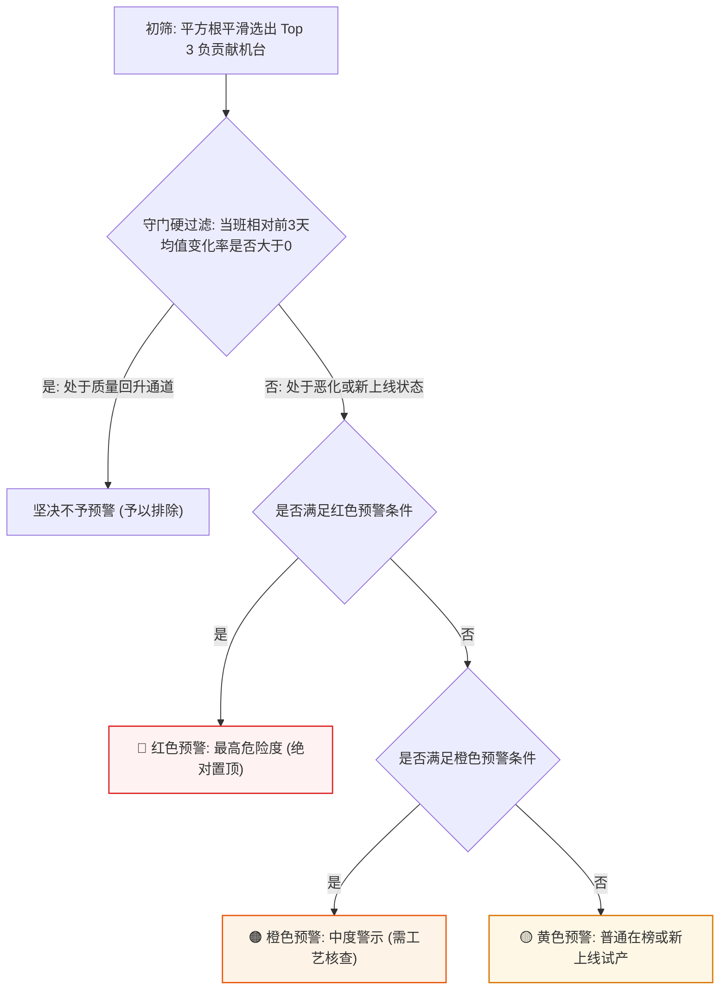

# 06. 参数调整改善评估与智能推荐算法 (Parameter Tuning Evaluation & CGRS Recommendation)

---

## 1. 为什么需要量化评估参数调整？（因果评估背景）

在轮胎车间，现场工艺员或班长常常会针对机台进行工艺微调。

系统引入因果评估算法的核心目的，就是**为了客观评估参数调整后机台的真实改善效果**（排除上下游工序或原材料波动的干扰），科学量化调参到底是改好了还是改坏了（计算逻辑收敛于 **`backend/services/cgrs_service.py`**）。

---

## 2. 参数调整改善度的具体计算方式 (受控因果回溯)

系统以 CGRS 调参变动日志中的事件时间戳 $T_{\text{event}}$ 为基准，采用**受控控制变量对比法**：

```mermaid
flowchart TD
    A["捕获参数修改事件 (机台/规格/时间戳 T_event)"] --> B["提取调参前样本 (Before) 与 调参后样本 (After)"]
    B --> C["全工序路径拆分: 严格锁定成型 ➔ 硫化 ➔ 终检相同物理组合"]
    C --> D{"路径双侧门槛检验:<br/>N_before >= 5 且 N_after >= 5"}
    D -->|不满足| E["直接剔除该路径 (防止小样本偶然性)"]
    D -->|满足| F{"样本量失衡校验:<br/>Max(N) / Min(N) <= 2.5"}
    F -->|失衡比例 > 2.5| E
    F -->|比例 <= 2.5 (样本均衡)| G["计算受控单路径增量:<br/>ΔCPK_path = CPK_after - CPK_before"]
    G --> H["汇总各受控路径得到调参综合改善度:<br/>ΔCPK_overall"]

    style G fill:#fef7e6,stroke:#d97706,stroke-width:1.5px
    style H fill:#edf7ed,stroke:#1e7e34,stroke-width:2px
```

### 2.1 四项核心防伪与样本收敛准则
为了确保计算得出的改善增量 $\Delta CPK$ 绝对置信，系统在 **`backend/services/cgrs_service.py`** 中执行 4 道硬核收敛过滤：

1. **控制变量全路径锁定**：
   - 评估成型机某次调参时，必须在下游锁定完全相同的硫化机与终检机（如仅对比 `TB254 ➔ CU621 ➔ TU05` 这一条固定通道内的前 20 胎与后 20 胎），排除下游机台干扰；
2. **双侧最低样本门槛 ($\ge 5$ 胎)**：
   - 单条受控路径改前与改后必须同时满足 $N_{\text{before}} \ge 5$ 且 $N_{\text{after}} \ge 5$；
3. **2.5 倍样本失衡整条过滤**：
   $$Ratio = \frac{\max(N_{\text{before}}, N_{\text{after}})}{\min(N_{\text{before}}, N_{\text{after}})} \le 2.5$$
   若比例超过 2.5（例如改前 20 胎，改后仅 5 胎），样本量悬殊直接导致方差统计不可比，**系统直接剔除该路径**；
4. **同一自然日隔离保护**：
   - 彻底杜绝跨日离散微调错误合并，确保改前与改后对比的时间紧凑性。

### 2.2 调参改善结论判定标准
* **改善成功 ($\Delta CPK > 0$)**：参数调整后受控路径质量显著提高，可作为标杆经验提炼推广；
* **调参恶化 ($\Delta CPK < 0$)**：参数调整反而加剧了质量变异，系统将触发警报提醒工艺员回调；
* **中性波动 ($\Delta CPK \approx 0$)**：调参未引起显著力学特性变化。

---

## 3. 三级状态指示灯 [红 / 橙 / 黄] 判定瀑布流

系统在核心行动表中，通过瀑布流判定算法为机台标记预警状态。具体计算逻辑收敛于核心服务 **`backend/services/machine_service.py`**：



### 3.1 守门硬过滤铁律 (Pre-Filtering Gate)
* 计算相对前 3 天历史均值变化率：$\Delta\% = \frac{T_0 - \mu_{3d}}{\mu_{3d}} \times 100\%$；
* **守门原则**：即使某机台排产量大，只要当班 CPK 相比前 3 天均值有正向改善（$\Delta\% > 0$），严格视为处于质量回升通道，**坚决不进入负向预警名单**。

### 3.2 预警等级具体判据
1. **🔴 红色预警（最高危险度 / 立即现场干预）**：
   - `[调参恶化]`：检测到 CGRS 调参事件，且受控控制变量对比证实 $\Delta CPK < 0$；
   - `[持续霸榜(#1)]`：该机台在近 3 天中有 $\ge 2$ 天位列全厂负贡献榜第 1 名。
2. **🟠 橙色预警（中度警示 / 质量突变）**：
   - `[骤降超35%]`：当班 CPK 相比前 3 天历史均值跌幅超过 35%（$\Delta\% \le -35\%$）；
   - `[持续在榜]`：近 3 天均进入负贡献榜但未达到霸榜。
3. **🟡 黄色预警（普通提示 / 监控关注）**：
   - `[新上线]`：观察日前 3 天无生产记录，今日新换型试产磨合；
   - `[负贡献在榜]`：当日单机 CPK 偏低。

---

## 4. 成型 / 硫化 / 终检多工段差异化智能参数推荐机制

针对处于异常或恶化状态的机台，系统在 **`backend/services/cgrs_service.py`** 与 **`backend/services/status_cgrs_service.py`** 中实现了工序差异化的推荐策略：

### 4.1 成型机 (GT/TB)：规格强绑定，同分期 30 天择优
* **工艺特性**：成型机工艺参数（如内衬层贴合位置、反包行程、定型环宽度）与轮胎结构尺寸深度强绑定；
* **智能推荐策略**：
  * 严格锁定**前 7 位规格编码 (`spec_prefix7`)**；
  * **优先级 1（同机同规格黄金经验）**：优先推荐本机台在该规格近 30 天内带来最大正向改善 $\Delta CPK$ 的历史参数；
  * **优先级 2（同工段同分期兄弟机借光）**：若本机历史无记录，从同分期（三期/四期）生产过该规格的优秀兄弟机中择优推荐最佳生效偏置。

### 4.2 硫化机 (CT/CU)：参数解耦规格，追溯固定机台最佳生产表现
* **工艺特性**：硫化温度、保压压力与延时时序往往按模具或机台组设定，与生胎规格弱解耦；
* **智能推荐策略**：从数据库中提取历史上生产该规格的固定硫化机列表，追溯发生参数修改后生产目标规格的实际 CPK 表现并择优推荐。

### 4.3 终检机 (TU)：不调参数，推荐标杆复检机台
* **工艺特性**：终检机为高精度力学测量试验机，不存在工艺配方调参；
* **行动建议**：系统自动调用 `get_best_tu_machine_for_spec`，在同分期设备中推荐全量历史 CPK 最高的标杆检测机（如 `推荐机台: TU19`），建议车间重点复检复核。

---

> [!TIP]
> **下一章导航**：
> 掌握了核心归因与调参推荐算法后，请阅读 [07. 前端看板交互与组件状态流转](07_frontend_dashboard_views.md)，了解前端如何呈现这些复杂的算法图表与联动交互！
