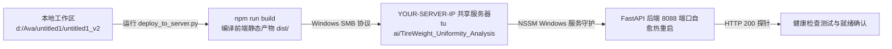

# 08. 系统运维部署、环境信息与红线守则 (DevOps, Environments & Engineering Redlines)

---

## 1. 系统环境网址与 Git 仓库全景表

开发、测试与交付运维人员可通过以下地址获取代码并访问对应系统环境：

### 1.1 Git 代码仓库信息
* **Git 远程仓库地址 (Remote URL)**：
  `https://github.com/mayuxiang666-eng/TireWeight_Uniformity_Analysis.git`
* **本地主工程根目录**：
  `d:\Ava\untitled1\untitled1_v2`
* **主开发分支**：
  `main`（主发布分支）/ `feature/kanban-onboarding-tour`（当前特性迭代分支）

---

### 1.2 本地开发环境访问网址 (Local Environment)
在本地运行 `npm run dev`（前端）与 `python backend/run_server.py`（后端 8088 端口）：

| 访问入口 | 网址 (URL) | 说明 |
| :--- | :--- | :--- |
| **本地前端看板 (热更新调试)** | [http://localhost:5173/](http://localhost:5173/) | Vite 开发服务器，支持前端代码实时热重载 (HMR) |
| **本地生产镜像看板** | [http://localhost:8088/](http://localhost:8088/) | FastAPI 挂载生产编译产物 `dist/` 的完整看板入口 |
| **本地技术交接 Wiki 文档** | [http://localhost:8088/wiki](http://localhost:8088/wiki) | 本地技术文档主页，集成左侧模块与力导向关系网络 |
| **本地 API 交互文档 (Swagger)** | [http://localhost:8088/docs](http://localhost:8088/docs) | FastAPI 自动生成的交互式 OpenAPI 接口调试台 |

---

### 1.3 局域网生产服务器访问网址 (Production Server)
系统常驻部署于厂区局域网内网服务器（IP：`YOUR-SERVER-IP`），车间工程师与班长无需安装任何客户端，直接通过内网浏览器访问：

| 访问入口 | 网址 (URL) | 说明 |
| :--- | :--- | :--- |
| **局域网智能分析大屏入口** | **[http://YOUR-SERVER-IP:8088/](http://YOUR-SERVER-IP:8088/)** | 全厂生产监控主看板，供车间大屏、现场工艺员与管理层日常使用 |
| **局域网系统维护 Wiki 文档** | **[http://YOUR-SERVER-IP:8088/wiki](http://YOUR-SERVER-IP:8088/wiki)** | 部署在服务器上的在线技术知识库，供厂区 IT 与工艺团队随时查阅 |
| **局域网 API 交互文档 (Swagger)** | **[http://YOUR-SERVER-IP:8088/docs](http://YOUR-SERVER-IP:8088/docs)** | 生产服务器后端在线接口调试文档 |
| **服务器 SMB 共享部署路径** | `\\YOUR-SERVER-IP\tu ai\TireWeight_Uniformity_Analysis` | Windows 局域网网络共享目录，用于接收增量发布文件 |

---

## 2. 生产环境局域网部署与一键自动化发布

系统采用**局域网共享服务器自动化部署架构**，开发工程代码与生产发布流程高度规范化：

### 2.1 一键部署脚本 (`deploy_to_server.py` / `一键部署到服务器.bat`)
在开发环境根目录下双击运行 `一键部署到服务器.bat`，脚本将自动串联执行：
1. **前端自动化构建**：调用 `npm run build`，生成压缩混淆的静态资源至 `dist/`；
2. **差异化增量覆盖**：将更新后的 `backend/`、`dist/`、`docs/` 及配置文件同步推送到服务器共享目录 `\\YOUR-SERVER-IP\tu ai\TireWeight_Uniformity_Analysis`；
3. **远端服务优雅重启**：触发远端 Windows 守护服务重启并执行 `/api/system/restart`；
4. **探针健康检查**：轮询 `http://YOUR-SERVER-IP:8088/api/etl/status` 直至返回正常状态。

### 2.2 核心配置文件与加密安全规范
系统配置统一归档于 `backend/config/`，维护人员须妥善保护：
* **`backend/config/db_config.json`**：存储 Redshift 与 MES 数据库的主机、端口与加密用户名/密码；
* **`backend/config/secret.key`**：32 位对称 XOR 混淆密钥，严禁提交到公共代码仓或明文分发；
* **`backend/config/etl_state.json`**：持久化记录增量同步的上次水位线时间戳，防止断点重启时全量重拉。

---

## 3. 架构开发与数据维护红线 (防劣铁律)

> [!CAUTION]
> **维护与二次开发红线守则 (绝对禁止违背)**：
> 1. **严禁人工硬编码伪造公差限值**：规格在 `Recipes.csv` 中未配置 USL/LSL 时，直接不计入 CPK，坚决不设任何假默认值！
> 2. **严禁跨工段与跨分期推荐**：成型设备（TB/GT）只能与成型比选，硫化设备（CU/CT）只能与硫化比选；三期设备严禁与四期设备混选推荐！
> 3. **严禁未来数据时间穿越**：在查询任何历史日期的质量和机台状态时，检索范围强制锁定为 `[target_date - 30天, target_date]`，绝对杜绝未来数据对历史观察日的数据污染！
> 4. **严禁在核心层引入反向依赖**：`backend/core/` 严禁反向 import `backend/services/`，保证纯函数核心层永远清洁、轻量、可独立测试。

---

> [!TIP]
> **下一章导航**：
> 系统运维与开发红线已明确，请阅读 [09. 智能分析看板用户操作手册](09_user_operation_manual.md)，查看面向现场工艺员与车间班长的实操图解指南！
