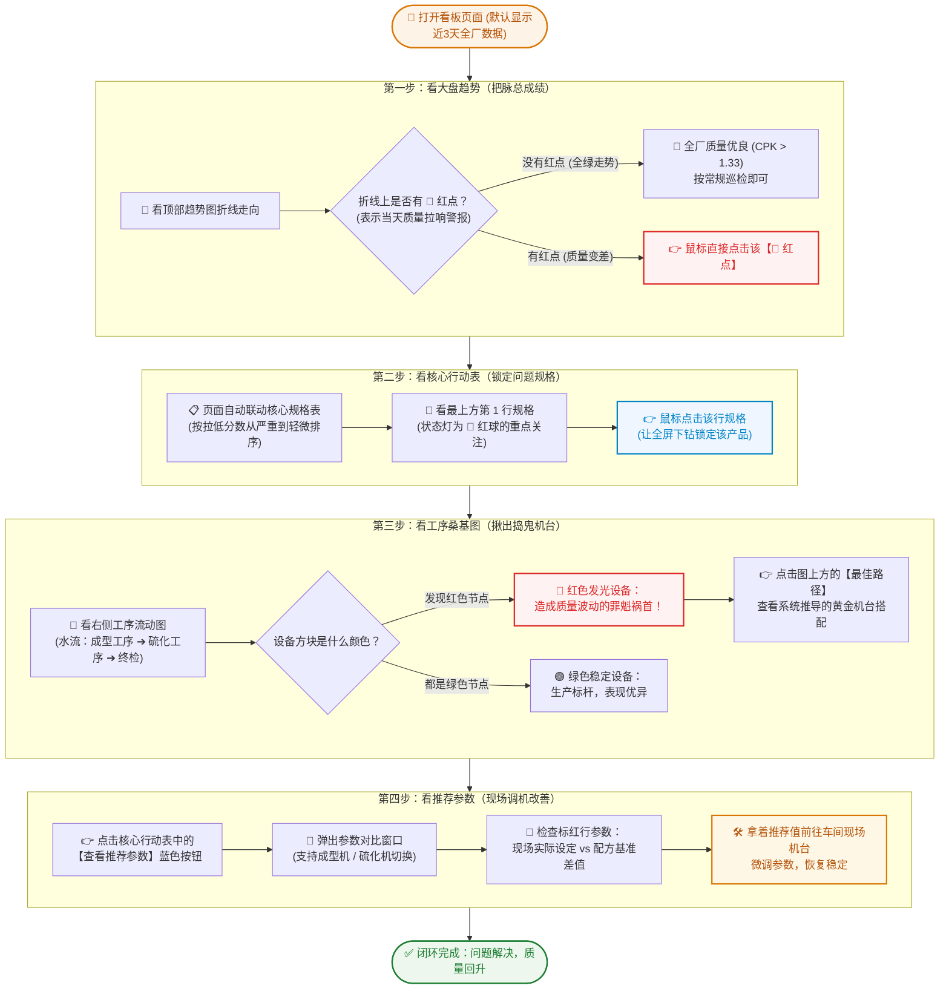
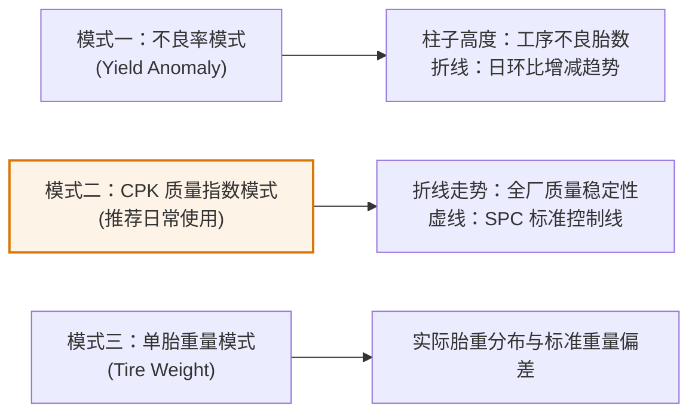
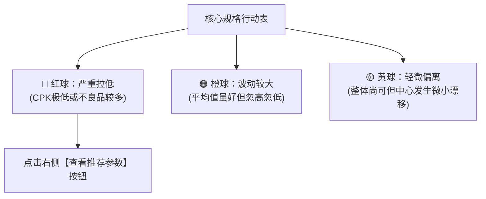
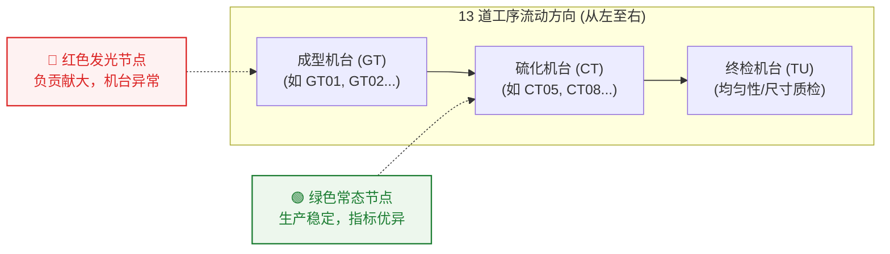
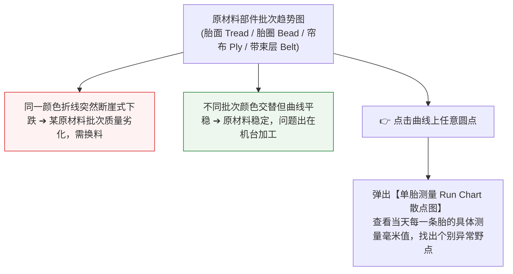
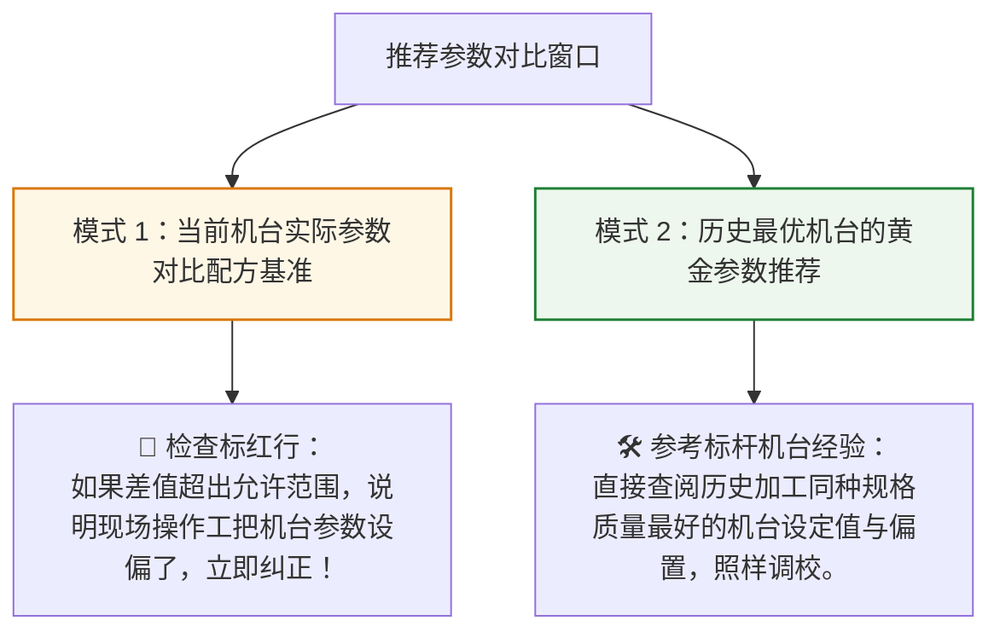

# 08. 智能分析看板用户操作手册 (车间小白实操指南)

---

## 1. 这个看板是帮您干什么的？（一分钟上手）

如果您是现场工艺员、质量工程师或车间班长，每天面对几千条轮胎质检数据，最头疼的就是：
1. **不知道今天哪个规格质量最差**；
2. **不知道到底坏在成型机还是硫化机**；
3. **知道机台有问题，但不知道参数该怎么调**。

这个看板就像一个**“工业老中医”**：
- **第一步给全厂把脉**：告诉您今天整体是健康还是拉响警报；
- **第二步揪出病灶**：直接在表格第一行给您列出“今天拉低分数最严重的规格”；
- **第三步定位病根**：用流程水流图告诉您是哪台成型机或硫化机出了问题；
- **第四步开出药方**：点击【查看推荐参数】，系统直接给出优化参考值，现场照着检查即可。

---

## 2. 看板完整使用排查全景流程图

整个排查过程非常简单，遵循**“由总到分、步步定位”**的极简 4 步法：

---

## 3. 看板各大板块通俗说明与计算公式

### 3.1 顶部宏观大盘（整体趋势图）

这是每天上班第一眼看的地方，提供三种观察模式：

#### 【关键公式通俗讲解】：什么是 CPK（质量稳定性指数）？
- **通俗比喻**：就像**“射击打靶”**。打靶不仅要求子弹尽量落在靶心（平均值准确），还要求子弹散布圆圈越小越好（波动小）。圈子越小、离脱靶边缘越远，分数就越高。
- **计算公式**：
  1. **单侧上限指标**（如跳动量、不平衡量，数值越小越好）：
     $$\text{CPK} = \frac{\text{标准允许的最大上限} - \text{实际测量的平均值}}{3 \times \text{实际波动离散度}(\sigma)}$$
     - **标准允许的最大上限**：图纸配方规定的红线，超过就判不合格；
     - **实际测量的平均值**：这批轮胎测出来的平均得分；
     - **实际波动离散度 ($\sigma$)**：大家成绩稳不稳定。波动越大，分母越大，算出来的 CPK 分数就越低。
  2. **双侧指标**（如锥度 CONY、重量，既不能太大也不能太小）：
     $$\text{CPK} = \frac{\text{实际平均值到最近那一侧公差红线的距离}}{3 \times \text{实际波动离散度}(\sigma)}$$

#### 【分数白话评级对照表】：
| CPK 得分区间 | 状态灯 | 大白话说明 | 车间行动建议 |
| :--- | :---: | :--- | :--- |
| **> 1.33 分** | 🟢 绿灯 | **学霸水平（能力极强）**：波动极小，几乎零不良 | 放心生产，按常规巡检 |
| **1.00 ~ 1.33 分** | 🟡 黄灯 | **及格边缘（勉强合规）**：稍有风吹草动就会超标 | 保持警惕，关注变动趋势 |
| **< 1.00 分** | 🔴 红灯 | **危险不及格（严重超标）**：正在批量产生不良品 | **必须立即停机或调参排查** |

> **红点小技巧**：点击折线上的任意一个 **🔴 红点**，下方行动表会自动切换为当天数据，并列出当天拉低分数最多的前 10 种规格。

---

### 3.2 核心行动表（谁在拉低全厂成绩？）

核心行动表把所有生产规格按照**“拖后腿严重程度”**从大到小排好序，第一名就是今天最大的问题：

- **表格字段大白话说明**：
  - **规格代码 (Article)**：轮胎的具体产品花纹型号；
  - **影响评分 (Stable Score)**：这个规格对全厂总成绩的“拉低负贡献度”。分数越高，说明它拖累全厂越狠；
  - **状态指示**：红/橙/黄球直观显示警报等级；
  - **工序机台推荐**：建议优先去检查哪道工序、哪个设备。

---

### 3.3 工序流转桑基图（哪台设备出了故障？）

展示一条轮胎从**【成型工序 (GT)】➔【硫化工序 (CT)】➔【终检 (TU/TG/TB)】**的完整生产水流：

- **颜色说明**：
  - **🔴 红色高亮发光**：说明流经该机台的轮胎质检变异大幅增加，该机台就是**问题机台**；
  - **🟢 绿色平稳**：说明机台运行正常。
- **按钮功能**：
  - **【单日实际工序路径】**：还原今天轮胎实际是在哪些机器之间流转的；
  - **【推荐最佳路径】**：系统根据历史大数据智能算出的**“黄金组合”**（比如哪台成型机配哪台硫化机质量最高）。

---

### 3.4 原材料与部件批次追溯（是不是胶料半成品的问题？）

有时候机台没问题，是因为**原材料批次发生变化**导致的质量突变。本图表帮您排除是“人机原因”还是“料的原因”：

---

### 3.5 推荐参数对比弹窗（拿给现场师傅怎么调？）

点击行动表的【查看推荐参数】后弹出的窗口，提供两大实用视图：

---

## 4. 常见问题小白速查（FAQ）

| 现场疑问 | 大白话解答与操作对策 |
| :--- | :--- |
| **Q1：为什么趋势图上有些日期打着红点？** | 说明当天全厂加权 CPK 分数跌破了警戒线（低于 1.33 或较前日突降）。**直接点击红点**，下面表格立刻出现罪魁祸首规格。 |
| **Q2：桑基图里成型机是绿的，硫化机是红的，代表什么？** | 说明半部件和生胎成型都很完美，但一进这台硫化机就产生超标变异，**重点检查这台硫化机的温控、充气压力或模具对中**。 |
| **Q3：推荐参数弹窗里的“偏置 (Offset)”是什么意思？** | 就是**微调的偏移量**。例如标准配方温度是 165℃，如果推荐偏置是 +2℃，现场设定值调整为 167℃ 最合适。 |
| **Q4：怎么只看某一个工期（如三期、四期）或某一天的数据？** | 在页面顶部的筛选工具栏中：期别下拉框选【三期/四期】、日期选【近三天/近一周/单日】，图表会在 0.5 秒内自动刷新。 |
